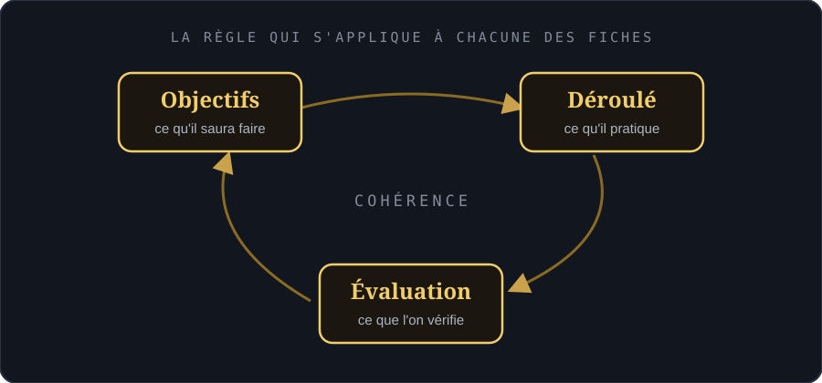
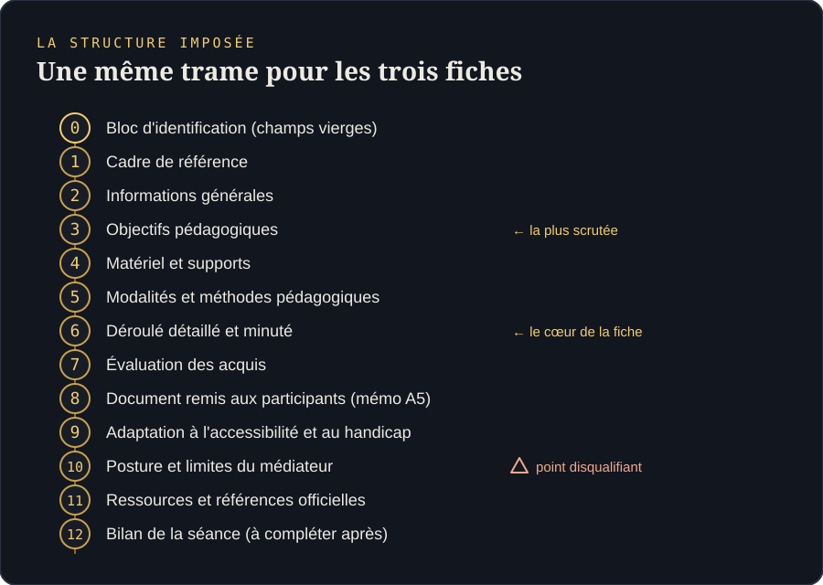
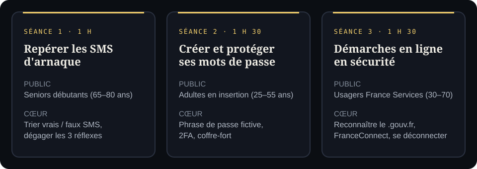
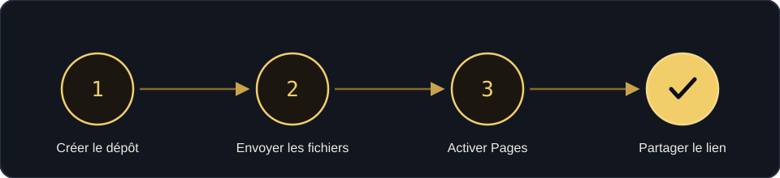

<div align="center">


# Cahier des charges — Construire ses fiches de séance

**Titre professionnel Médiateur Numérique · RNCP 40695 · Centre de Formation MODE 83 (Draguignan)**

[](https://pythonman83.github.io/cahier-des-charges-mediateur-numerique/)
[](#-structure-du-dépôt)
[](#-fonctionnalités-de-la-page)
[](#-accessibilité)

</div>

---

## 📖 Présentation

Cette page web est un **cahier des charges pas à pas** destiné aux stagiaires de la formation **Médiateur Numérique**. Elle ne contient **aucune fiche toute faite** : elle donne la commande précise — ce que le jury attend, la structure imposée et les critères de réussite — pour que chaque stagiaire construise **lui-même, à partir d'une page vierge**, ses **trois fiches de séance**.

Les séances portent sur la **sécurisation des pratiques numériques** d'un public adulte (bloc **BC02**), au format des trois fiches de séance du bloc **BC01**.

> [!NOTE]
> La répartition exacte des livrables entre blocs peut être précisée localement : chaque stagiaire confirme l'attendu de sa session avec son formateur.

---

## 🎯 Le principe directeur : l'alignement pédagogique

<div align="center">

</div>

Un jury vérifie d'abord une chose : **chaque objectif annoncé est réellement travaillé dans le déroulé, puis vérifié à l'évaluation.** Toute la page est construite autour de ce triangle.

---

## 🧭 Contenu de la page

| Section | Ce qu'on y trouve |
|---|---|
| **Le livrable attendu** | 3 fiches de 2 à 3 pages, imprimables et modifiables (Word ou PDF), champs d'identification vierges, pied de page paginé |
| **Les 9 règles d'or** | Alignement · verbes observables · le participant pratique · minutage juste · deux colonnes d'action · sécurité intégrée · jamais à la place · accessible à tous · sources officielles |
| **La structure imposée** | Bloc d'identification + 12 rubriques, chacune avec son **critère de réussite** jury et des exemples |
| **Les trois sujets** | Les briefs des trois séances à construire |
| **La grille d'auto-évaluation** | 11 cases à cocher pour relire chaque fiche avant de rendre |
| **Les pièges** | 6 erreurs qui coûtent des points |
| **Ce qu'il faut retenir** | Le récapitulatif en 5 points |

### La trame commune aux trois fiches

<div align="center">

</div>

### Les trois séances à construire

<div align="center">

</div>

| | Séance | Public | Durée | Lieu |
|---|---|---|---|---|
| 1 | Repérer les SMS d'arnaque | Seniors débutants (65–80 ans) | 1 h | Salle commune, résidence autonomie |
| 2 | Créer et protéger ses mots de passe | Adultes en insertion (25–55 ans) | 1 h 30 | Salle informatique d'un EPN |
| 3 | Faire ses démarches en ligne en sécurité | Usagers d'une Maison France Services (30–70 ans) | 1 h 30 | Espace numérique |

*Durées et effectifs sont des propositions à ajuster au contexte réel.*

---

## ✨ Fonctionnalités de la page

- 🌗 **Thème clair / sombre** — suit la préférence du système, mémorisé ensuite ; transition circulaire depuis le bouton sur les navigateurs compatibles (View Transitions API).
- 🔠 **Trois tailles de texte** (A / A / A) — agrandissent réellement *tous* les textes, titres fluides et schéma compris.
- 🎬 **Intro animée** à l'ouverture (rideau doré), passable d'un clic ou d'une touche.
- ☑️ **Grille d'auto-évaluation cochable**, avec mise en valeur des lignes cochées.
- 📊 **Barre de progression de lecture** et frise des rubriques qui s'illumine au fil du défilement.
- ⬆️ **Bouton « retour en haut »** avec effet sonore (Web Audio API, généré à la volée — aucun fichier audio).
- ☕ **QR code Ko-fi** interactif (effet 3D au survol) pour soutenir le formateur.
- 💫 Fonds vivants : aurore dorée, poussière d'or (canvas), projecteur qui suit la souris.

---

## ♿ Accessibilité

- Police **Atkinson Hyperlegible**, conçue pour les personnes malvoyantes.
- Contrastes travaillés dans les deux thèmes.
- Lien d'évitement **« Aller au contenu »**, focus clavier visible, attributs `aria-pressed` sur les boutons de réglage.
- **`prefers-reduced-motion` respecté** : intro, poussière d'or, aurores et animations sont désactivées pour qui le demande à son système.
- Mise en page responsive, du téléphone au grand écran.

---

## 📁 Structure du dépôt

```
cahier-des-charges-mediateur-numerique/
├── .nojekyll                       ← publication directe, sans traitement Jekyll
├── index.html                      ← la page (HTML + CSS + JS dans un seul fichier)
├── README.md
└── img/
    ├── sceau-cahier-des-charges.png  ← favicon (requis)
    ├── qrcode.png                    ← QR code Ko-fi (requis)
    ├── questions-jury-bc02.png       ← visuel « Questions du jury » (non utilisé par la page)
    └── readme/                       ← illustrations de ce README
        ├── banniere.svg
        ├── alignement.svg
        ├── structure.svg
        ├── seances.svg
        └── deploiement.svg
```

> [!IMPORTANT]
> `index.html` appelle deux images qui doivent être présentes dans le dossier `img/` : **`sceau-cahier-des-charges.png`** (favicon) et **`qrcode.png`** (QR code Ko-fi). Les noms sont sensibles à la casse sur GitHub Pages.

---

## 🚀 Mise en ligne sur GitHub Pages

<div align="center">

</div>

### 1. Créer le dépôt
Sur GitHub, **New repository** → nom : `cahier-des-charges-mediateur-numerique` → visibilité **Public** → *Create repository*.

### 2. Envoyer les fichiers

**Par l'interface web** : *Add file → Upload files*, glisser `index.html`, `README.md` et le dossier `img/`, puis *Commit changes*.

**Ou en ligne de commande** :
```bash
git init
git add .
git commit -m "Cahier des charges — fiches de séance Médiateur Numérique"
git branch -M main
git remote add origin https://github.com/pythonman83/cahier-des-charges-mediateur-numerique.git
git push -u origin main
```

### 3. Activer GitHub Pages
**Settings → Pages** → *Source* : **Deploy from a branch** → branche **`main`**, dossier **`/ (root)`** → *Save*.

### 4. Partager le lien
Après une à deux minutes, la page est en ligne à l'adresse :

```
https://pythonman83.github.io/cahier-des-charges-mediateur-numerique/
```

> [!TIP]
> Pour la distribuer en salle, générez un QR code de cette adresse et projetez-le : les stagiaires l'ouvrent directement sur leur téléphone.

---

## 🛠️ Personnalisation

| À modifier | Où |
|---|---|
| Couleurs du thème | Variables CSS `:root` / `[data-theme="dark"]` et `[data-theme="light"]` en tête de fichier |
| Les trois sujets de séance | Section `<!-- TROIS SUJETS -->` (cartes `.brief`) |
| La grille d'auto-évaluation | Section `<!-- CHECKLIST -->` (ajouter un `<li>` avec un `id` unique `checkN`) |
| Le lien de soutien | Balise `<a class="qr" href="https://ko-fi.com/ondeaweb">` et image `img/qrcode.png` |
| L'année de session | Calculée automatiquement (`new Date().getFullYear()`) dans l'en-tête et le pied de page |

Les préférences de chaque visiteur (thème, taille de texte) sont enregistrées dans son navigateur sous les clés `cdc-theme` et `cdc-size`.

---

## 🔗 Références officielles citées

- [France Compétences — fiche RNCP 40695](https://www.francecompetences.fr/recherche/rncp/40695/)
- [cybermalveillance.gouv.fr](https://www.cybermalveillance.gouv.fr/) · [17cyber.gouv.fr](https://www.17cyber.gouv.fr/)
- [service-public.fr](https://www.service-public.fr/) · [franceconnect.gouv.fr](https://franceconnect.gouv.fr/)
- [cnil.fr](https://www.cnil.fr/) · [aidantsconnect.beta.gouv.fr](https://aidantsconnect.beta.gouv.fr/)

---

## 👤 Auteur

**Jean-Claude Lugo** — Formateur expert, Centre de Formation **MODE 83**, Draguignan (Var)
Conception et développement : **Ondea Web Studio**

[](https://github.com/pythonman83)
[](https://ko-fi.com/ondeaweb)

<div align="center">
<sub>Support pédagogique destiné aux stagiaires de la session Médiateur Numérique — MODE 83.</sub>
</div>
